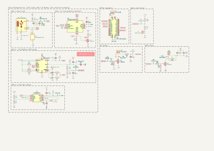
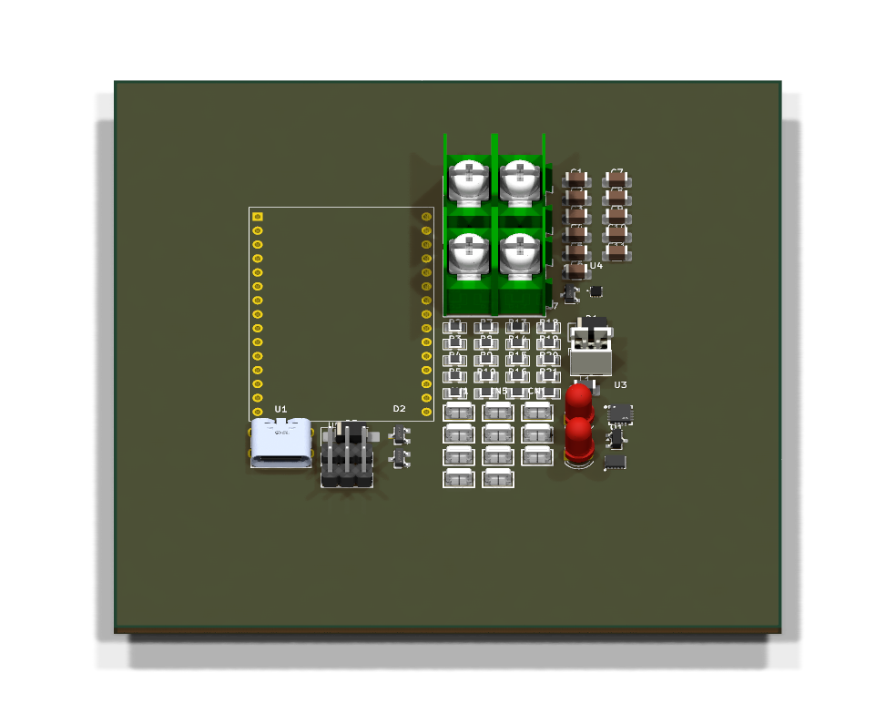
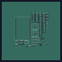

# 🌱 Smart Plant Pot

A self-contained plant pot that waters plants automatically and connects to Home Assistant over Wi-Fi. The project brings together custom ESP32 firmware, a custom PCB, and purpose-designed pots with the water reservoir, sensors, pump, and electronics inside.

[Development checklist](#development-checklist) · [Getting started](#getting-started) · [Firmware guide](firmware/README.md) · [Schematic](#schematic) · [PCB previews](#pcb-previews)

> **Work in progress:** firmware and electronics are being prototyped. Soil moisture readings and MQTT discovery are implemented; the complete automatic watering pot is still under development.

## The plant pot

The pot is intended to take care of routine watering while keeping everything in one unit:

- A soil moisture sensor measures when the plant needs water.
- A pump delivers water from an internal reservoir.
- A water level sensor monitors the reservoir so the system knows when it needs refilling.
- Custom firmware manages sensing, watering, and communication with Home Assistant over Wi-Fi and MQTT.
- A custom PCB and printable pot bring the electronics and water system together, with access for refilling and maintenance.

Home Assistant will provide moisture and reservoir readings, watering status, and manual watering controls. Automatic watering should run on the pot itself; its behavior during network outages is part of the firmware design.

## Development checklist

Start by testing the sensors and pump together, then use that prototype to finish the PCB and pot design. Validate automatic watering under supervision before an extended plant trial.

### Sensors and pump

- [ ] Validate moisture calibration and reading stability in the intended soil.
- [ ] Choose and test a water level sensor for the reservoir.
- [ ] Control the pump manually and measure water delivered for different runtimes.
- [ ] Test the power supply with the ESP32, sensors, and pump running together.

### Firmware and Home Assistant

- [ ] Add reservoir level, watering status, and manual pump control to MQTT discovery.
- [ ] Implement configurable moisture thresholds and watering amounts, with time for water to soak in between cycles.
- [ ] Stop or prevent watering on invalid readings or an empty reservoir, and enforce a maximum pump runtime.
- [ ] Define and test behavior after power loss and during Wi-Fi or MQTT outages.

### Custom PCB

- [ ] Complete the schematic using the tested components and power requirements.
- [ ] Finish PCB layout and resolve relevant ERC/DRC findings.
- [ ] Manufacture and assemble a prototype board, then test sensing, pump control, and Wi-Fi together.

### Integrated pot

- [ ] Plan the soil area, reservoir capacity, and space for the pump, sensors, and PCB.
- [ ] Design water routing and an electronics compartment protected from moisture.
- [ ] Add access for refilling, cleaning, and repairs, then print and test the pot for fit and leaks.

### Complete system

- [ ] Test watering amounts and sensor behavior with everything installed in the pot.
- [ ] Run an extended plant trial and refine calibration and watering settings.
- [ ] Document the parts, assembly, firmware setup, and maintenance.

## Getting started

To try the current firmware, you need an ESP32 development board compatible with
PlatformIO's `esp32dev` target, an analog soil moisture sensor, PlatformIO, Wi-Fi,
and an MQTT broker. Home Assistant is optional for initial testing. The
[firmware guide](firmware/README.md) lists the requirements and setup instructions.

Clone the repository with its library submodule. The commands below use GitHub SSH access, including for the `rhadar` submodule:

```sh
git clone --recurse-submodules git@github.com:Excse/plant-watering-system.git
cd plant-watering-system/firmware
```

For an existing checkout, run `git submodule update --init --recursive` from the repository root.

Follow the [firmware guide](firmware/README.md) to wire the sensor, configure Wi-Fi and MQTT, flash the ESP32, calibrate readings, and connect Home Assistant.

## Schematic

[](docs/schematic/pcb.svg)

*Click the preview to open the full-size SVG.*

Open [pcb/pcb.kicad_pro](pcb/pcb.kicad_pro) in KiCad to explore the editable design. GitHub Actions keeps the preview updated when the schematic or project files change on the default branch.

Local symbols, footprints, and 3D models are organized in [pcb/libraries/](pcb/libraries/README.md).

## PCB previews

<p align="center">
  <a href="docs/pcb/3d.png"></a>
</p>

*3D view of the current design. Click to enlarge; components appear where a 3D model is assigned.*

<table>
  <tr><th>Front</th><th>Back</th></tr>
  <tr>
    <td><a href="docs/pcb/front.svg"></a></td>
    <td><a href="docs/pcb/back.svg"></a></td>
  </tr>
</table>

*Copper and silkscreen, cropped to the board. Click either preview to enlarge; the back is mirrored to show the underside.*

The [KiCad checks and previews workflow](https://github.com/Excse/plant-watering-system/actions/workflows/kicad.yml) runs **ERC** and **DRC** for hardware changes and updates these previews on the default branch. See [hardware documentation](docs/README.md) for report and preview-generation details.

## Repository layout

| Directory | Contents |
| --- | --- |
| [firmware/](firmware/) | ESP32 source, PlatformIO configuration, and setup instructions |
| [pcb/](pcb/) | KiCad project, schematic, PCB, and local component libraries |
| [docs/](docs/) | Schematic and PCB previews, plus hardware automation documentation |
| [scripts/](scripts/) | KiCad rule checks and preview generation |
| [.github/workflows/](.github/workflows/) | Automation for hardware checks and preview updates |
